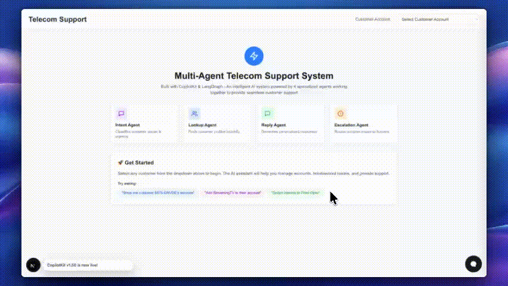

<div align="center">


<br />
<br />

# Multi-Agent Telecom Support with CopilotKit

### A customer support copilot with four cooperating LangGraph agents

A Turborepo monorepo with a Next.js CopilotKit sidebar and a LangGraph agent. The agent classifies intent, looks up a customer, generates a reply and decides on escalation for a telecom company.

<br />

[![Built by Studio1](https://img.shields.io/badge/Built_by_Studio1-f97316?style=for-the-badge&logo=data%3Aimage%2Fsvg%2Bxml%3Bbase64%2CPHN2ZyB4bWxucz0iaHR0cDovL3d3dy53My5vcmcvMjAwMC9zdmciIHZpZXdCb3g9IjAgMCAxNjAgMTYwIiBmaWxsPSJub25lIj48cGF0aCBmaWxsLXJ1bGU9ImV2ZW5vZGQiIGNsaXAtcnVsZT0iZXZlbm9kZCIgZD0iTTAgMzVDMCAxNi42ODA3IDE0LjA3NDQgMS42NDg0NCAzMiAwLjEyNjk1M1YxNDFINTEuMDUyM0M1Mi40MzA4IDEzNy4zNDQgNTQuNzQ0NiAxMzMuNjg5IDU3Ljk5MzggMTMwLjAzM0M2MS4xNDQ2IDEyNi41MDggNjQuNjg5MiAxMjMuNDQgNjguNjI3NyAxMjAuODI5QzcyLjU2NjIgMTE4LjM0OSA3Ni4zNTY5IDExNi43ODIgODAgMTE2LjEyOVY4Ni43NTQ0Qzc1LjQ3MDggODcuOTI5MiA3MS4zODQ2IDg5LjY5MTkgNjcuNzQxNSA5Mi4wNDE1QzY0IDk0LjUyMjUgNjAuNzUwOCA5Ny40NiA1Ny45OTM4IDEwMC44NTRDNTYuNTM0NSAxMDIuNzIgNTUuMjU0NSAxMDQuNjU5IDU0LjE1MzkgMTA2LjY3MVYwSDEyNUMxNDQuMzMgMCAxNjAgMTUuNjY5OSAxNjAgMzVWMTI1QzE2MCAxNDQuMzMgMTQ0LjMzIDE2MCAxMjUgMTYwSDEyNFYxOEgxMDQuOTQ4QzEwMy41NjkgMjEuNjgxNiAxMDEuMjU1IDI1LjM2MjggOTguMDA2MiAyOS4wNDQ0Qzk0Ljg1NTQgMzIuNTk0MiA5MS4zMTA4IDM1LjY4NDEgODcuMzcyMyAzOC4zMTRDODMuNDMzOCA0MC44MTIgNzkuNjQzMSA0Mi4zODk2IDc2IDQzLjA0NzRWNzIuNjMwNEM4MC41MjkyIDcxLjQ0NzMgODQuNjE1NCA2OS42NzI0IDg4LjI1ODUgNjcuMzA1N0M5MiA2NC44MDc2IDk1LjI0OTIgNjEuODQ5MSA5OC4wMDYyIDU4LjQzMDdDOTkuNDY1NSA1Ni41NTEzIDEwMC43NDUgNTQuNTk4NiAxMDEuODQ2IDUyLjU3MjNWMTYwSDM1QzE1LjY3IDE2MCAwIDE0NC4zMyAwIDEyNVYzNVoiIGZpbGw9IiNmZmZmZmYiLz48L3N2Zz4K)](https://studio1hq.com)
[](https://copilotkit.ai)

[CopilotKit docs](https://docs.copilotkit.ai) &nbsp;·&nbsp; [CopilotKit](https://copilotkit.ai) &nbsp;·&nbsp; [More examples](https://github.com/Studio1HQ) &nbsp;·&nbsp; [studio1hq.com](https://studio1hq.com)

</div>

<br />

## Overview

An AI customer support app for a fictional telecom company, built with [CopilotKit](https://copilotkit.ai) and [LangGraph](https://www.langchain.com/langgraph). A customer or support rep chats in a CopilotKit sidebar. A LangGraph agent handles the inquiry, looks up the customer's plan, writes a personalised answer and escalates complex issues to a human team.

The repo is a monorepo managed with [Turborepo](https://turbo.build) and pnpm workspaces. `apps/web` is the Next.js frontend and `apps/agent` is the LangGraph agent.

<p align="center"></p>

<details>
<summary>Demo video</summary>

https://github.com/user-attachments/assets/49a9dd02-046b-49af-8631-88fcabfd1e19

</details>

## Features

- **Intent Agent**: Classifies the customer's message and sets its urgency.
- **Customer Lookup Agent**: Retrieves the customer profile and service details from sample data.
- **Reply Agent**: Generates a personalised response from the intent and customer context.
- **Escalation Agent**: Decides whether to route the issue to a human support team.
- **CopilotKit sidebar**: Chat UI and shared state between the web app and the agent, with frontend actions available to the agent.
- **Customer context in the UI**: The web app tracks the current customer and shows service pricing details.

## Tech stack

| Layer | Tool |
| --- | --- |
| Frontend | [Next.js](https://nextjs.org/) 16, React, TypeScript |
| Copilot | [CopilotKit](https://copilotkit.ai) 1.50 (`react-core`, `react-ui`, `runtime`) |
| Agent | [LangGraph](https://www.langchain.com/langgraph) JS, `@copilotkit/sdk-js` |
| LLM | [OpenAI](https://platform.openai.com/) (`gpt-4o` for the chat node, `gpt-5-nano` for the escalation tool) via `@langchain/openai` |
| Monorepo | [Turborepo](https://turbo.build), [pnpm](https://pnpm.io) workspaces |

## Getting started

### Prerequisites

- Node.js 18 or later
- [pnpm](https://pnpm.io/installation) 9.15.0 or later
- An [OpenAI API key](https://platform.openai.com/api-keys) for the LangGraph agent

### Installation

```bash
git clone https://github.com/Studio1HQ/support-help.git
cd support-help
pnpm install
```

### Environment variables

| Variable | Description |
| --- | --- |
| `OPENAI_API_KEY` | OpenAI key for the agent. Put it in `apps/agent/.env`. |
| `LANGGRAPH_DEPLOYMENT_URL` | Optional. URL of the LangGraph server. Defaults to `http://localhost:8123`. |
| `LANGSMITH_API_KEY` | Optional. LangSmith key passed to the LangGraph agent connection. |

```bash
cd apps/agent
echo "OPENAI_API_KEY=your-openai-api-key-here" > .env
```

### Run

Start both apps with Turborepo. The Next.js app runs on port 3000 and the LangGraph agent on port 8123:

```bash
pnpm dev
```

Open [http://localhost:3000](http://localhost:3000). Other scripts:

- `pnpm dev:studio`: start the web app and the agent with the LangGraph Studio UI.
- `pnpm build`: build all apps.
- `pnpm lint`: lint all apps.

Run one app at a time with pnpm filters:

```bash
pnpm --filter web dev
pnpm --filter agent dev
```

If you see "I'm having trouble connecting to my tools", check that the LangGraph agent is running, your OpenAI key is set and both servers started.

## How it works

```text
.
├── apps/
│   ├── web/     # Next.js frontend with the CopilotKit sidebar
│   └── agent/   # LangGraph agent
├── pnpm-workspace.yaml
├── turbo.json
└── package.json
```

- `apps/web/src/app/api/copilotkit/route.ts` creates a `CopilotRuntime` with a `LangGraphAgent` (`starterAgent`) that points at the LangGraph server.
- `apps/agent/src/agent.ts` builds the graph. The chat node binds the CopilotKit frontend actions plus four tools: `intentClassifierTool`, `customerLookupTool`, `escalationDecisionTool` and `replyGeneratorTool`. The system prompt tells the model to classify intent, look up the customer, check escalation and then generate the reply.
- `apps/agent/src/agents/` holds the four agent nodes and `apps/agent/src/types/state.ts` the shared state.
- The main UI is `apps/web/src/app/page.tsx`. Edit it to change theme colours, add frontend actions or use shared state.
- A GitHub Actions workflow (`smoke.yml`) runs a smoke test on Ubuntu, Windows and macOS with Node 20 and 22.

## Resources

- [CopilotKit docs](https://docs.copilotkit.ai): the runtime, UI components and LangGraph integration.
- [CopilotKit](https://copilotkit.ai): the copilot framework used here.
- [LangGraph docs](https://langchain-ai.github.io/langgraph/): the agent workflow library.
- [Next.js documentation](https://nextjs.org/docs): the frontend framework.

## License

Released under the [MIT License](LICENSE).

<br />

---

<div align="center">

<a href="https://studio1hq.com">
  <picture>
    <source media="(prefers-color-scheme: dark)" srcset="https://raw.githubusercontent.com/Studio1HQ/website/main/brand/studio1-logo-on-dark.svg" />
    
  </picture>
</a>

Built by **[Studio1](https://studio1hq.com)**, the technical content and DevRel partner for devtool teams. Made with [CopilotKit](https://copilotkit.ai).<br />
Browse more open-source examples at [github.com/Studio1HQ](https://github.com/Studio1HQ).

[](https://studio1hq.com)
[](https://cal.com/studio1/collab)
[](https://x.com/Studio1HQ)
[](https://www.linkedin.com/company/studio1hq/)

<sub><a href="https://studio1hq.com">studio1hq.com</a> · Technical content, docs, video and DevRel for devtools</sub>

</div>
